# Proverse - Task Management System

Proverse is a responsive web-based task and project management system developed using Django and MySQL.

It allows users to create and manage projects, collaborate with other users, assign and track tasks, invite users to projects, and manage their personal profiles.

## Features

### Public Features

- Responsive home page
- Proverse introduction and overview
- Public projects available without login
- Public project discovery and join option
- About page
- Contact section
- User sign in
- User registration

### User Dashboard

After signing in, users can access:

- Dashboard
- Invitations
- My Projects
- My Tasks
- Account
- Public Projects

The dashboard provides an overview of:

- Number of projects owned by the user
- Number of assigned tasks
- Invitations received
- Project join requests
- Uncompleted tasks

### Project Management

Users can:

- Create projects
- View their projects
- View project details
- Edit project details
- Delete projects
- Set projects as public or private
- Set project start and end dates
- Invite other users
- View project team members

Project information includes:

- Project title
- Project description
- Project status
- Start date
- End date
- Project owner
- Team members

### Project Collaboration

Users can:

- Browse public projects
- Request to join public projects
- Cancel join requests
- Receive project invitations
- Accept project invitations
- Reject project invitations
- View project team members
- Invite other users to their projects

### Task Management

Project owners can:

- Create tasks
- Edit tasks
- Delete tasks
- Assign tasks to project team members
- Assign tasks to themselves
- Set task status
- Set task priority
- Set task due date

Task statuses include:

- Todo
- Progress
- Done

Users can also:

- View tasks assigned to them
- Open task details
- Update the status of their assigned tasks

### Account Management

Users can manage their account information, including:

- Full name
- Username
- Email
- Gender
- Role
- Skills

Available roles include:

- Developer
- Designer
- Manager
- Others

Available skills include:

- Python
- JavaScript
- HTML
- CSS
- Django
- React
- Others

Users can also:

- Edit account details
- Change password

## Technology Stack

### Backend

- Python
- Django

### Database

- MySQL

### Frontend

- HTML
- CSS
- JavaScript
- Responsive web design

## Project Structure

```text
proverse/
|
|-- account/
|   |-- migrations/
|   |-- admin.py
|   |-- apps.py
|   |-- models.py
|   |-- tests.py
|   `-- views.py
|
|-- member/
|   |-- migrations/
|   |-- admin.py
|   |-- apps.py
|   |-- models.py
|   |-- tests.py
|   `-- views.py
|
|-- stage/
|   |-- migrations/
|   |-- admin.py
|   |-- apps.py
|   |-- models.py
|   |-- tests.py
|   `-- views.py
|
|-- proverse/
|   |-- settings.py
|   |-- urls.py
|   |-- asgi.py
|   `-- wsgi.py
|
|-- static/
|   |-- CSS files
|   |-- JavaScript files
|   `-- images
|
|-- templates/
|   `-- HTML templates
|
|-- screenshots/
|   |-- 01-home.png
|   |-- 02-home-mobile.png
|   |-- 03-public-projects-guest.png
|   |-- 04-about.png
|   |-- 05-signin.png
|   |-- 06-signup.png
|   |-- 07-dashboard.png
|   |-- 08-my-projects.png
|   |-- 09-create-project.png
|   |-- 10-project-details.png
|   |-- 11-manage-project.png
|   |-- 12-invite-users.png
|   |-- 13-create-task.png
|   |-- 14-manage-task.png
|   |-- 15-my-tasks.png
|   |-- 16-public-projects-user.png
|   |-- 17-invitations.png
|   `-- 18-account.png
|
|-- .env.example
|-- .gitignore
|-- manage.py
|-- requirements.txt
`-- README.md
```
## Screenshots

### 1. Home Page

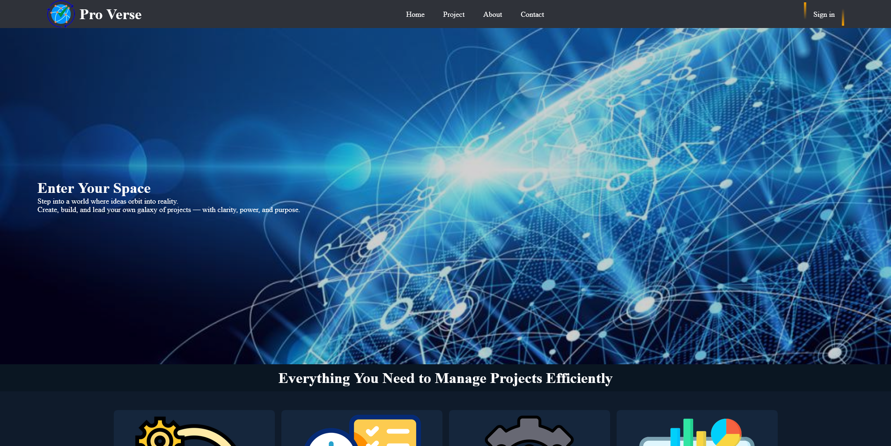

### 2. Responsive Home Page - Mobile


### 3. Public Projects - Guest

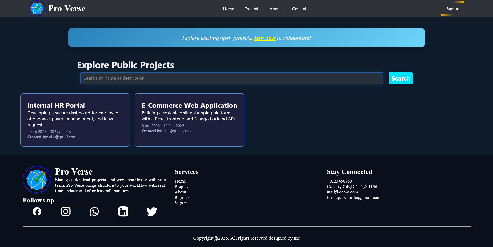

### 4. About Page

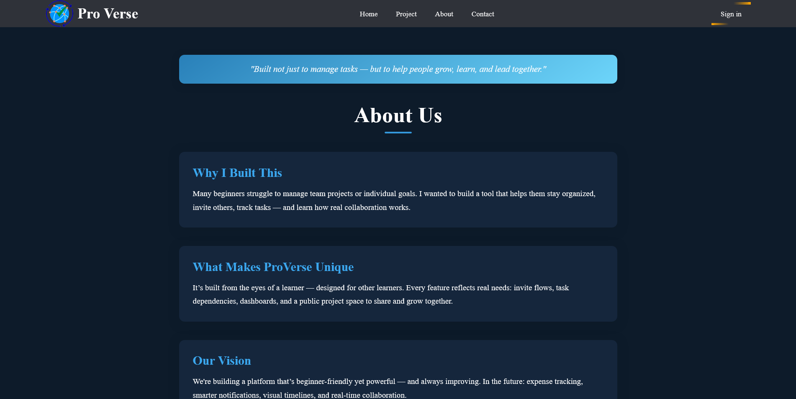

### 5. Sign In

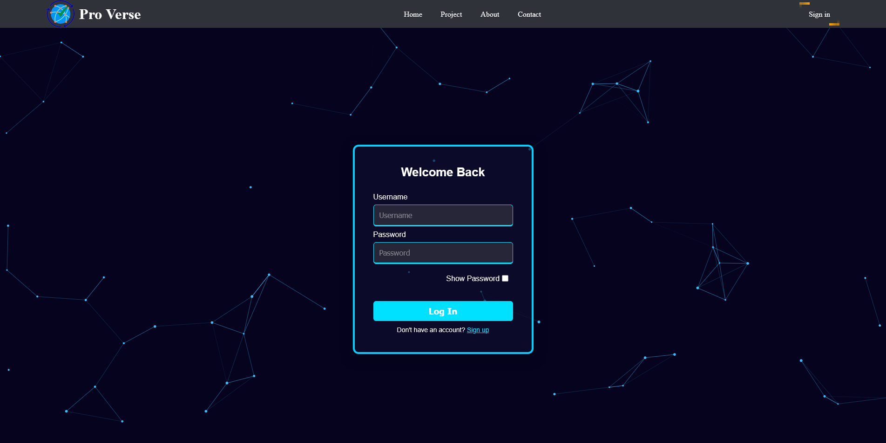

### 6. Sign Up

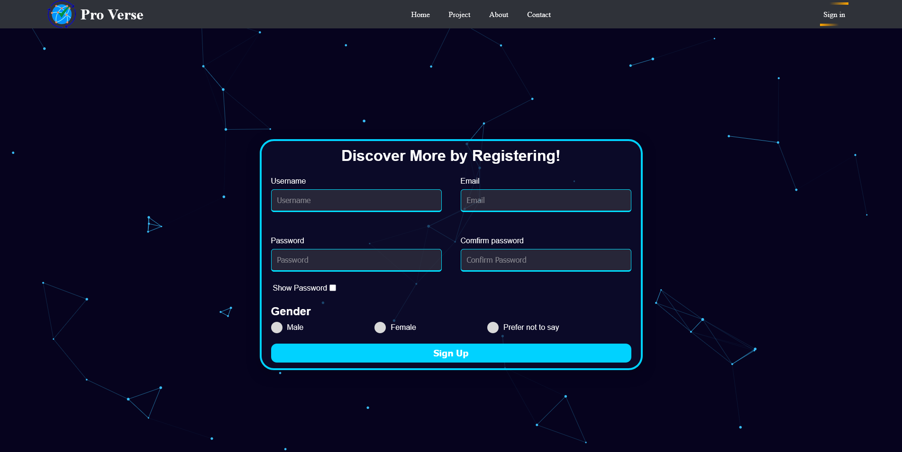

### 7. Dashboard

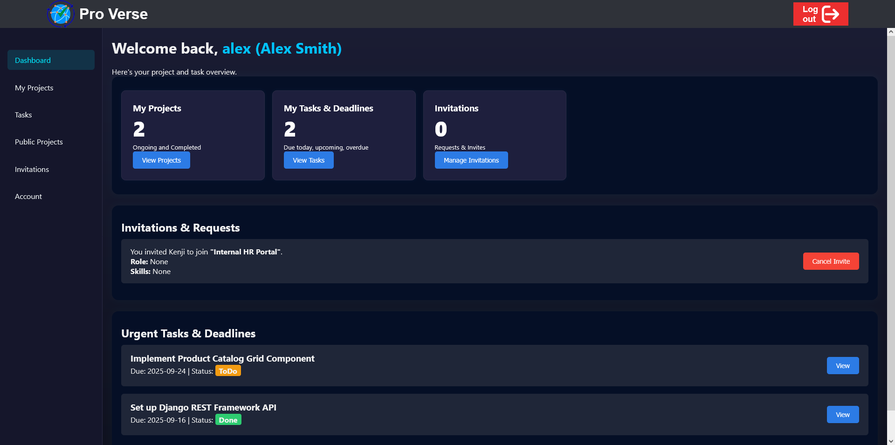

### 8. My Projects

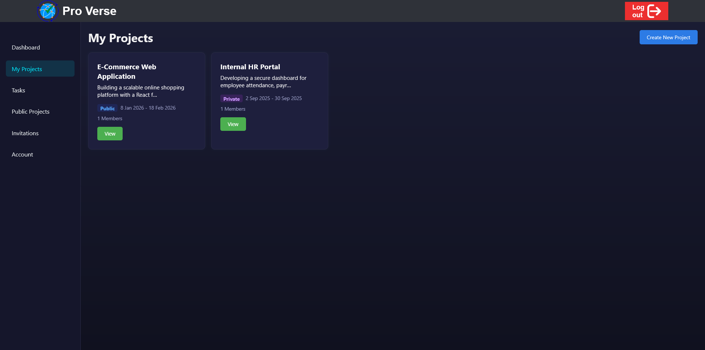

### 9. Create Project

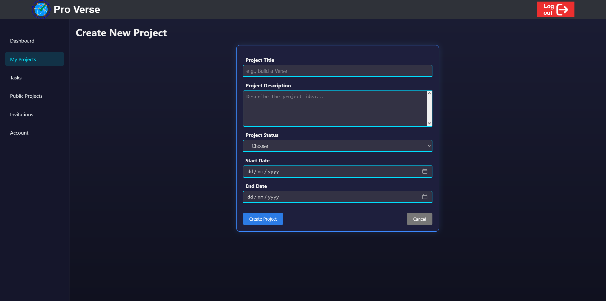

### 10. Project Details

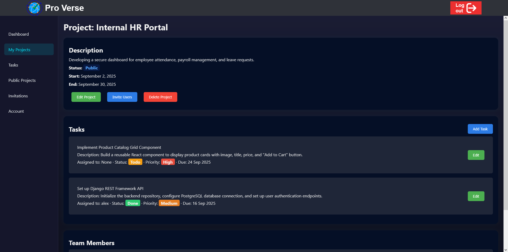

### 11. Manage Project

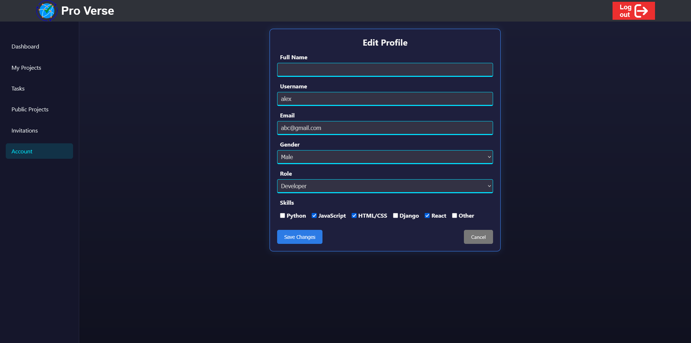

### 12. Invite Users

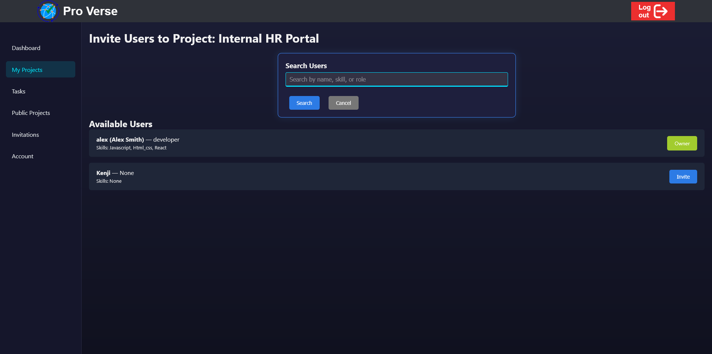

### 13. Create Task

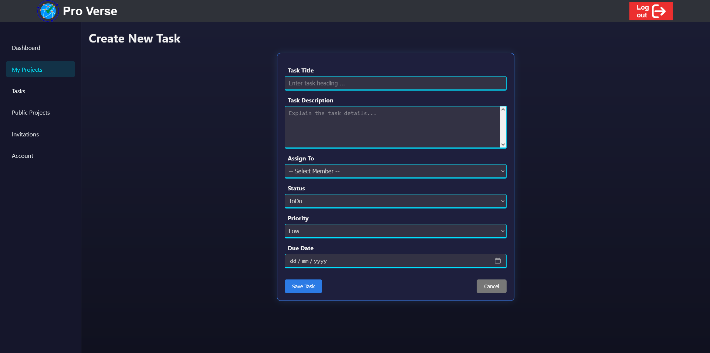

### 14. Manage Task

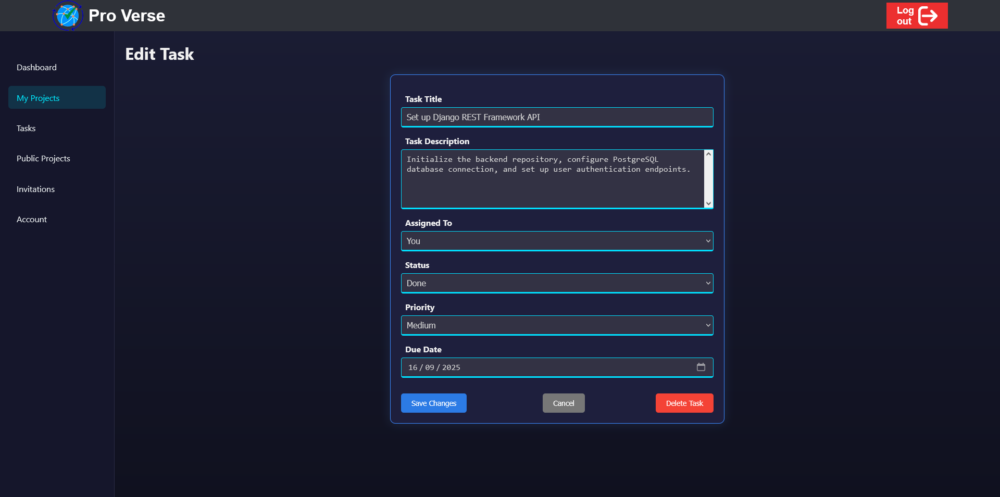

### 15. My Tasks

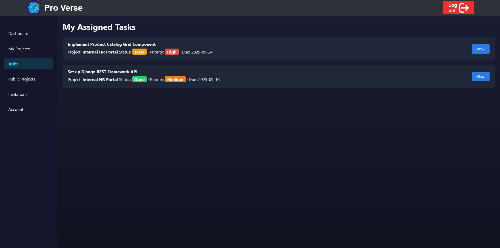

### 16. Public Projects - Logged In User

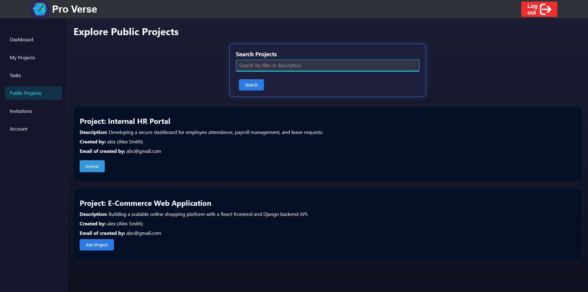

### 17. Invitations

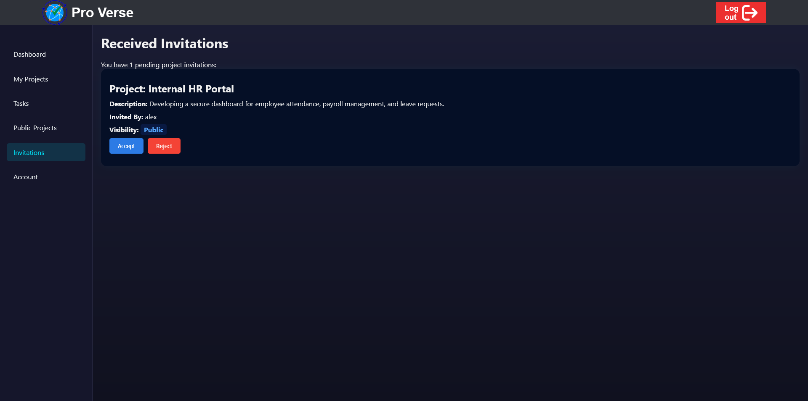

### 18. Account

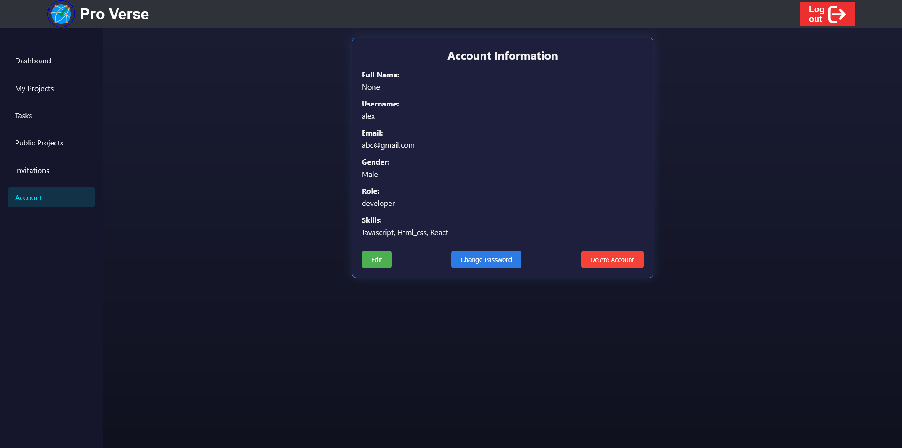

## Installation

### 1. Clone the Repository

```bash
git clone <YOUR_GITHUB_REPOSITORY_URL>
cd proverse
```
### 2. Create a Virtual Environment
```bash
python -m venv venv
```
### 3. Activate the Virtual Environment
Windows
```bash
venv\Scripts\activate
```
macOS / Linux
```bash
source venv/bin/activate
```
### 4. Install Dependencies
```bash
pip install -r requirements.txt
```
### 5. Configure Environment Variables

Create a .env file in the project root directory.

Use .env.example as a reference.

Example:
```bash
SECRET_KEY=your_secret_key
DEBUG=True

DB_NAME=your_database_name
DB_USER=your_mysql_username
DB_PASSWORD=your_mysql_password
DB_HOST=localhost
DB_PORT=3306
```
Do not upload the actual .env file to GitHub.
### 6. Create the MySQL Database

Create a MySQL database using the database name configured in your .env file.
### 7. Apply Django Migrations

```bash
python manage.py migrate
```

### 8. Create a Superuser

```bash
python manage.py createsuperuser
```

Follow the instructions shown in the terminal.
### 9. Run the Development Server

```bash
python manage.py runserver
```

Open the local development server address shown in the terminal.
Environment Variables

The application uses environment variables for sensitive configuration.

The following variables are used:

```bash
SECRET_KEY
DEBUG
DB_NAME
DB_USER
DB_PASSWORD
DB_HOST
DB_PORT
```

The actual .env file is excluded from Git using .gitignore.

The .env.example file is included as a template so that the required environment variables are clear without exposing private credentials.
## Database

Proverse uses MySQL as its database system.

Django migration files are included in the repository.

After configuring the database, run:
```bash
python manage.py migrate
```
This creates the required database tables.
## Security

Sensitive information should not be committed to the repository.

The following information should remain private:

- Database passwords

- Django secret key

- API keys

- Other private credentials

The .env file is excluded from Git using .gitignore.

The repository contains .env.example with placeholder values instead of real credentials.
## Responsive Design

Proverse is designed to be responsive across:

- Desktop

- Tablet

- Mobile

The project includes responsive layouts for the application pages.
Application Flow
```bash
Guest User
    |
    |-- Home
    |-- Public Projects
    |-- About
    |-- Contact
    `-- Sign In / Sign Up
              |
              v
       Authenticated User
              |
              |-- Dashboard
              |
              |-- My Projects
              |      |-- Create Project
              |      |-- Project Details
              |      |-- Manage Project
              |      `-- Invite Users
              |
              |-- My Tasks
              |      `-- Task Details
              |
              |-- Invitations
              |
              |-- Public Projects
              |
              `-- Account
                     |-- Edit Account
                     `-- Change Password
```
## Learning Outcomes

This project demonstrates practical experience with:

- Python programming

- Django web development

- MySQL database integration

- User authentication

- CRUD operations

- Database relationships

- Django models

- Django migrations

- Form handling

- Project management

- Task management

- User collaboration

- Invitation management

- Public and private projects

- Responsive web design

- Static files

- Environment variables

- Git and GitHub project management


## License

This repository is intended primarily for portfolio and project demonstration purposes.

The source code is provided for viewing and evaluation purposes only. All rights are reserved by the author unless otherwise stated.

No permission is granted to copy, modify, distribute, reproduce, commercially use, or reuse the source code or project materials without prior written permission from the author.

For permission to use or reuse any part of this project, please contact the author.